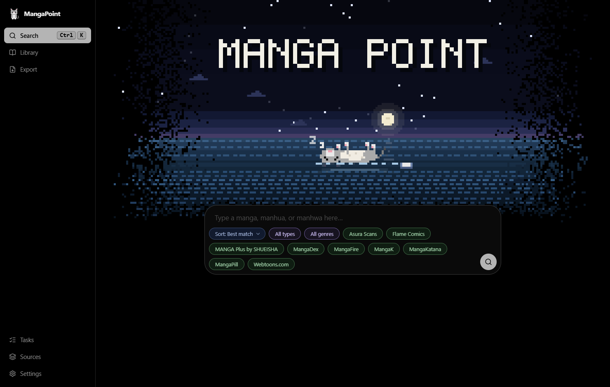
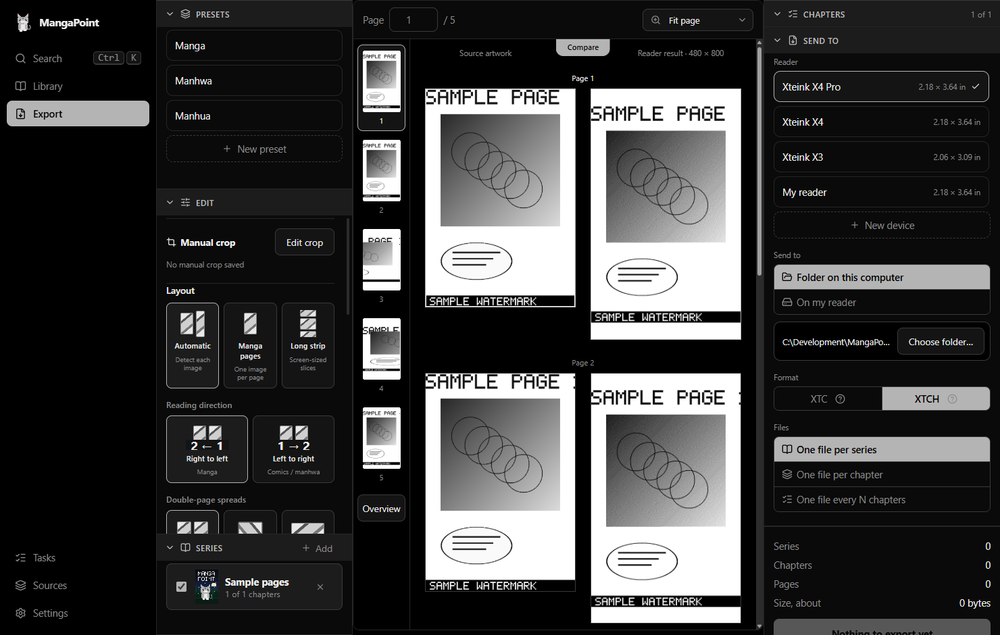

<div align="center">


# MangaPoint

**Find manga, download it, and send it to your e-ink reader at exactly the size and format it wants.**

[](https://github.com/W1seGit/MangaPoint/actions/workflows/ci.yml)
[](https://github.com/W1seGit/MangaPoint/releases/latest)
[](LICENSE)


[Download](https://github.com/W1seGit/MangaPoint/releases/latest) ·
[Features](#features) ·
[Getting started](#getting-started) ·
[Build from source](#build-from-source) ·
[Contributing](CONTRIBUTING.md)



</div>

---

MangaPoint is a desktop app for reading manga, manhwa and manhua on e-ink
readers. You search many sources at once, pick chapters, and it downloads them,
converts every page for your reader's screen (cropping, grayscale, dithering,
double-page spreads, long strips cut into screen-sized slices) and writes files
the reader opens directly. It was built for the Xteink readers (X4, X4 Pro, X3)
and also makes standard EPUB files for Kindle, Kobo, Boox, PocketBook and
reMarkable.

Everything runs on your computer. There is no account and no server of ours.

## Features

**Search and download**
- One search across all your installed sources. Results for the same series from
  several sources are grouped into one card, and the best source for each is
  picked by looking at its chapter list.
- Covers and descriptions come from whichever source answers first.
- Chapter lists from all sources are merged, with gaps flagged. A download falls
  back to another source when a page fails.
- A queue with pause, resume, retry and reordering; downloads continue where they
  stopped after the app is closed.
- A library of what you have, with sizes, covers and one place to delete a
  series or just some of its chapters.

**Convert**
- Pages are made at your reader's own size and density: automatic crop, manual
  crop, double-page spreads, long strips cut into slices, contrast, and several
  dithering styles.
- A live preview with a side-by-side "Compare" against the original, and presets
  (Manga, Manhwa, Manhua, and your own).

**Export**
- Three formats: **XTC** (black and white, smallest and fastest), **XTCH** (four
  grays) and a fixed-layout **EPUB 3** of page pictures. Chapters become the
  table of contents.
- Send to a folder, a USB drive or SD card (found automatically, with a "Safe to
  unplug" message), or over Wi-Fi.
- One file per series, per chapter, or every N chapters. Very long series are cut
  into parts so no single file is too big for the reader.

**Readers**
- A catalog of 29 readers from Xteink, Amazon, Kobo, Boox, PocketBook and
  reMarkable with their screen sizes, densities and file formats. Add your own by
  typing a name and a size.
- Each reader has its own folder, export method, firmware (CrossPoint or stock) and
  the formats it opens, and the Export screen only offers those formats.

<div align="center">

</div>

## Supported readers

| Maker | Readers | Output |
|---|---|---|
| Xteink | X4, X4 Pro, X3 (with CrossPoint or stock firmware) | XTC, XTCH, EPUB |
| Amazon | Kindle Paperwhite, Oasis, Scribe and others in the catalog | EPUB (through Send to Kindle) |
| Kobo | Clara, Libra, Sage, Elipsa and others | EPUB |
| Boox, PocketBook, reMarkable | The models in the catalog | EPUB |

The reader list is in [`crates/device-profiles`](crates/device-profiles/src/lib.rs).
If yours is missing, add it as your own reader in **Settings → Your reader** (a
name, the screen size in inches and its pixels per inch) and pick EPUB.

> **A note on testing.** The conversion, the file formats and the app are tested
> automatically and by hand on Windows. The Xteink formats are checked against a
> parser that follows the firmware's own, but files have not yet been tried on
> every reader listed, and the macOS and Linux builds are produced by CI but not
> yet hand-tested. Reports are very welcome.

## Getting started

### Install

Download the file for your system from the
[latest release](https://github.com/W1seGit/MangaPoint/releases/latest):

| System | File | How to run it |
|---|---|---|
| Windows 10/11 (64-bit) | `MangaPoint-…-windows-x86_64.zip` | Unzip and run `MangaPoint.exe`. Needs the Microsoft Edge WebView2 runtime (included in Windows 11). |
| macOS, Apple silicon | `MangaPoint-…-macos-arm64.zip` | Unzip and move `MangaPoint.app` to Applications. |
| macOS, Intel | `MangaPoint-…-macos-x86_64.zip` | The same. |
| Linux (64-bit) | `MangaPoint-…-linux-x86_64.tar.gz` | Extract and run `./mangapoint`. Needs `webkit2gtk-4.1` and GTK 3 (see [Linux packages](#linux-packages)). |

Each release also has `SHA256SUMS.txt` to check your download.

**macOS:** the app is not signed or notarized yet, so macOS will say it cannot
verify the developer the first time. Right-click `MangaPoint.app`, choose
**Open**, then **Open** again. Or run `xattr -cr /Applications/MangaPoint.app`.

### First run

The first start walks you through three steps:

1. **Engine.** MangaPoint finds manga through the open-source
   [Suwayomi](https://github.com/Suwayomi/Suwayomi-Server) server. Press Install
   and it downloads a pinned, checksum-verified copy with its own Java into
   MangaPoint's data folder. Nothing is installed system-wide.
2. **Sources.** Pick the sources to search. The recommended ones can be installed
   with one button.
3. **Reader.** Search for your reader or type a name and a screen size.

### Use it

1. **Search** a title (press `/` or `Ctrl+K`), open a result, tick chapters, and
   add them to the downloads.
2. Watch them in **Tasks**; the finished ones are in your **Library**.
3. Select a series in the library, press **Export**, check the preview, choose
   where to send it, and export.

Keyboard: `/` or `Ctrl+K` (`⌘K` on a Mac) search, `Esc` closes what is open,
arrows and `Space` move and tick in the chapter table.

## Your data

MangaPoint keeps everything in one folder:

| System | Folder |
|---|---|
| Windows | `%APPDATA%\MangaPoint` |
| macOS | `~/Library/Application Support/MangaPoint` |
| Linux | `$XDG_DATA_HOME/mangapoint` (usually `~/.local/share/mangapoint`) |

Inside are your settings, library, downloaded pages (the download folder can be
changed in **Settings → Downloads**), the engine, and `logs/mangapoint.log`
(rolled over at 2 MB). To use another folder, set `MANGAPOINT_HOME`.

## Build from source

You need [Rust](https://rustup.rs) (stable). Then:

```sh
git clone https://github.com/W1seGit/MangaPoint.git
cd MangaPoint
cargo run -p mangapoint            # run the app (debug build)
cargo build --release -p mangapoint   # an optimised build in target/release
```

Debug builds optimise the libraries on purpose, so conversion is fast even under
`cargo run`.

### Linux packages

On Debian and Ubuntu:

```sh
sudo apt install libwebkit2gtk-4.1-dev libgtk-3-dev libxdo-dev libssl-dev \
  libayatana-appindicator3-dev libdbus-1-dev pkg-config
```

### Tests and checks

```sh
cargo clippy --workspace --all-targets --features catalog/fake,converter/decode -- -D warnings
cargo test   --workspace --features catalog/fake,converter/decode
python -m unittest tools/test_release.py
```

On Windows, `tools/ui-smoke.ps1 -Exe <path to mangapoint.exe>` also clicks
through the app with real mouse events.

### Developer switches

| Switch | What it does |
|---|---|
| `-- --onboarding` or `MANGAPOINT_ONBOARDING=1` | Walk through the first-run setup again |
| `-- --toast-demo` | Show one notification of each kind |
| `MANGAPOINT_HOME=<folder>` | Use another data folder |
| `MANGAPOINT_LOG=mangapoint=debug,error` | Change what is logged |
| `MANGAPOINT_DEBUG_PORT=9222` | Let UI tests connect to the web view (local only) |

## How it works

```
 Search ─► Suwayomi (local server, loopback only) ─► sources
              │
 Download queue ──► page files on disk ──► converter ──► XTC / XTCH / EPUB ──► folder · USB · Wi-Fi
```

| Crate | Role |
|---|---|
| `apps/desktop` | The app: screens (Dioxus), queue, notifications, covers |
| `crates/converter` | Page processing and the XTC/XTCH encoders and parser (no I/O) |
| `crates/device-profiles` | The catalog of readers |
| `crates/catalog` | Installs and talks to the Suwayomi server |
| `crates/sources` | Source and extension management, health checks |
| `crates/search` | Fan-out search, grouping, ranking, chapter merging |
| `crates/pipeline` | Downloads, conversion, EPUB writing and export targets |
| `crates/library` | Settings, library, presets and exports on disk |

## Releases and versions

Versions follow [Semantic Versioning](https://semver.org). What changes the
version is the title of what is merged, written as a
[Conventional Commit](https://www.conventionalcommits.org): `feat:` raises the
minor version, `fix:` and `perf:` the patch version, and `feat!:` the major
version. Documentation, tests and maintenance alone do not make a release. A
release pull request is opened from the Actions tab, and merging it builds all
platforms and publishes the release. The details are in
[CONTRIBUTING.md](CONTRIBUTING.md#releases-and-versions); every change is listed
in the [changelog](CHANGELOG.md).

## Known limitations

- Wi-Fi export is slow, because readers take files slowly over their built-in
  transfer; USB or the SD card in your computer is much quicker.
- EPUB files and the Xteink chapter menu and covers still need checking on more
  real readers.
- Apart from the cover, XTC, XTCH and EPUB files do not yet carry the author or
  description.
- macOS builds are unsigned.

## Responsible use

MangaPoint is a tool for reading content on your own devices. It does not host
or provide any manga. Sources are third-party extensions made for Suwayomi;
what they offer, and whether you may download it, depends on the source and your
country's law. You are responsible for how you use it. Please support the
creators and licensed releases where you can.

MangaPoint is not affiliated with or endorsed by Xteink, Amazon, Kobo, Onyx (Boox),
PocketBook, reMarkable or any manga source. Their names are used only to say
which devices it works with.

## Acknowledgements

- [Suwayomi-Server](https://github.com/Suwayomi/Suwayomi-Server) and the
  Mihon/Tachiyomi extension community, which make the sources possible.
- [CrossPoint](https://github.com/crosspoint-reader/crosspoint-reader), the
  open firmware for the Xteink readers.
- [Dioxus](https://dioxuslabs.com), the UI framework, and the Rust crates this
  project stands on (see `Cargo.lock`).

## License

[MIT](LICENSE) © 2026 MangaPoint contributors.
